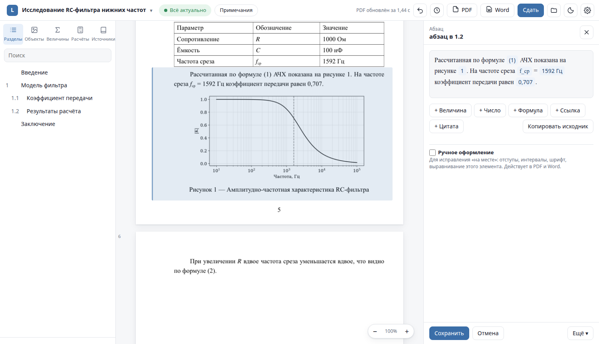
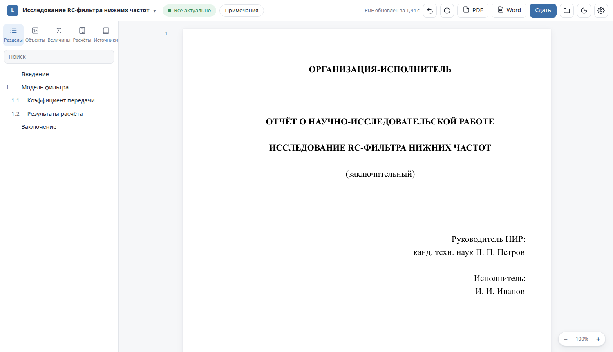
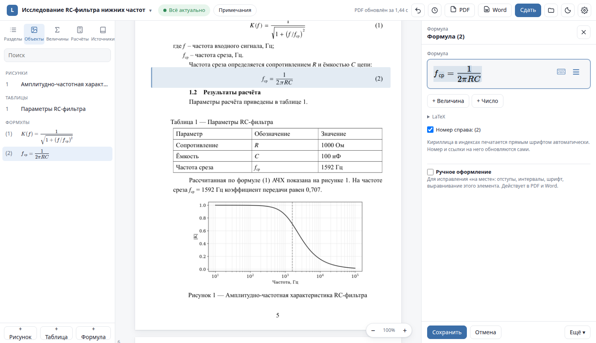
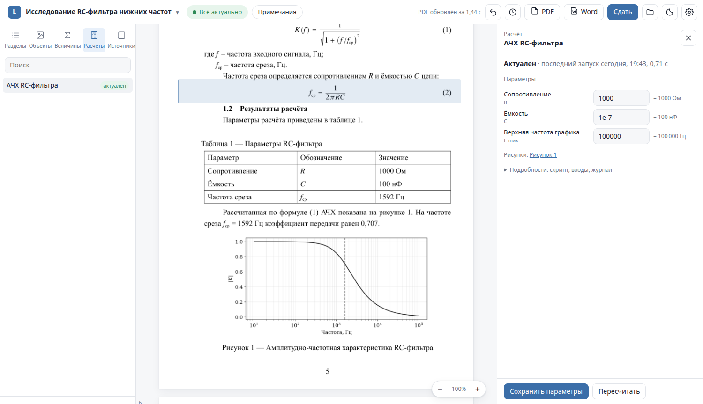
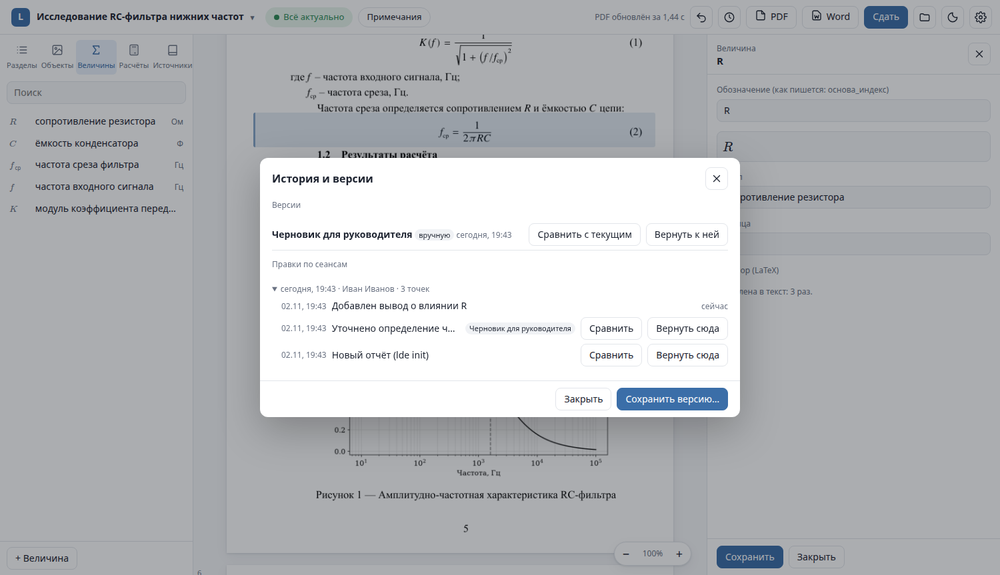
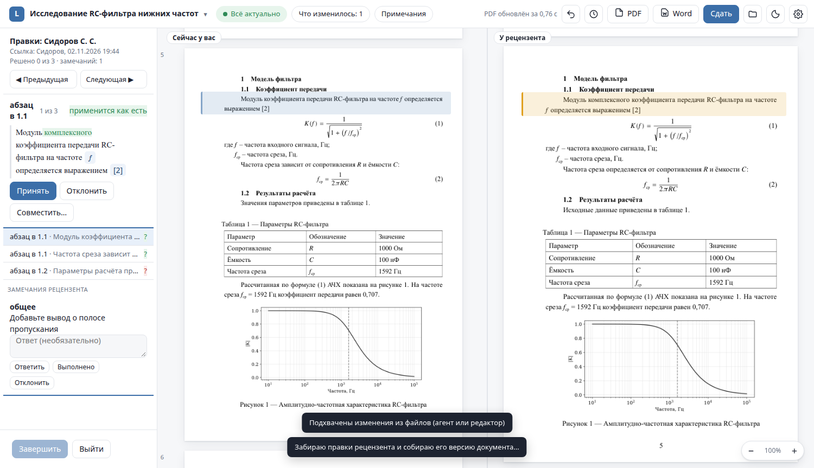
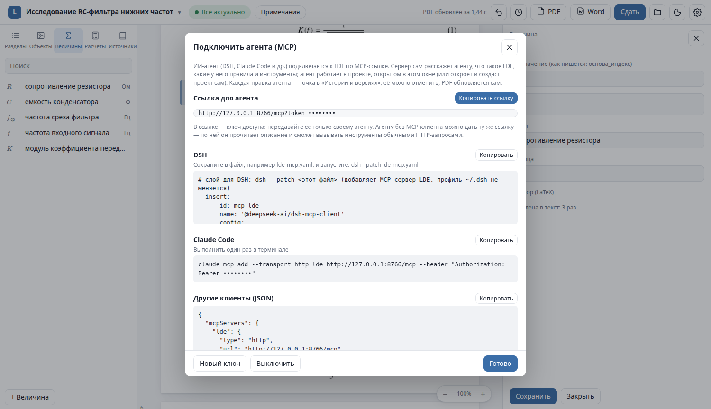
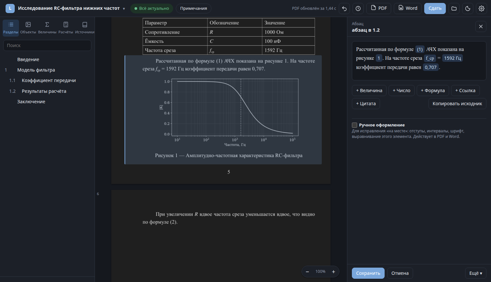
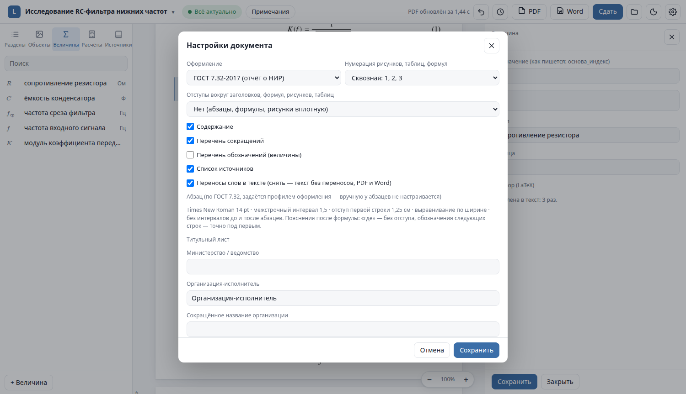

<div align="center">

# LDE — reports as code, typeset to GOST 7.32

**Write the text, keep the numbers in scripts, get a print-ready PDF and an editable Word file.**
**LDE Studio lets you click any element of the real PDF to edit it — and lets an AI agent work alongside you.**

**English** · [Русский](README.ru.md)




</div>

> LDE targets Russian technical documentation: research reports, theses and explanatory notes formatted
> per **GOST 7.32-2017** (and similar university profiles). The user interface and the generated documents
> are in Russian; this README and the guides are in English.

## Why LDE

A technical report is more than text. It has quantities with symbols and units, numbers that come out of
calculations, figures produced by scripts, equations, tables, references — and strict formatting rules.
In Word all of that is copied by hand, and every change of an input parameter means hunting for stale
numbers and renumbering figures.

LDE treats a report as a **project**:

- **Text** lives in plain Markdown-like files (`text/*.md`), one paragraph per line — easy to diff and review.
- **Quantities** (`{R}`), **numbers from calculations** (`{=afc.f_c}`), **cross-references** (`@fig:afc`) and
  **citations** (`[@ivanov2020]`) are *inserts*, not typed text — LDE fills them in and keeps them consistent.
- **Calculations** are scripts with parameters (`calc/<key>/`). Change a parameter and LDE tells you exactly
  which figures and numbers are stale and why, then recomputes only those.
- **Formatting** (margins, headings, numbering, captions, table of contents, bibliography) is done by LDE
  according to the profile — you never format by hand.
- **Output**: PDF via XeLaTeX (the canonical result) and DOCX for Word, both always generated from the source.
- **Every edit is a version point** (git underneath): undo any step, compare versions element by element,
  restore, merge.

## Features

| | |
|---|---|
| 🖱️ **LDE Studio** | Desktop-style app: the real PDF in the middle; click a paragraph, equation, figure or table to edit it on the right. Inserts are shown as chips. |
| 🧮 **Visual equations** | MathLive editor with LaTeX underneath; quantities and calculation results can be inserted *into* equations and stay live. |
| 📈 **Calculations** | Python scripts with typed parameters editable in Studio; outputs (figures, JSON values, CSV tables) are tracked by content hash. |
| ✅ **Checks** | `lde check` finds quantities typed as text, hand-typed numbers that match a calculation, manual figure numbers, etc. — with a one-click fix. |
| 📄 **Word round trip** | Import an existing Word report (OMML and MathType equations, numbering, references); export DOCX with post-processing and a self-check against the PDF. |
| 🕓 **History & versions** | Undo/redo, named versions, element-wise and word-level diffs, restore, block-level merge. |
| 👥 **Review links** | Send a link to a supervisor: they edit and comment in their own copy in the browser; you accept or reject each change in a side-by-side review mode. End-to-end encrypted. |
| 🤖 **AI agents** | Built-in MCP server: connect Claude Code, DSH or any MCP client with one link — the agent edits the project open in Studio, every change is an undoable point. |
| 🖥️ **Self-hosted server** | Optional `lde-server` (Docker): review links and encrypted project sync. The server never sees document contents. |

## Screenshots

| | |
|---|---|
|  <br> **Document.** The real PDF; the outline, objects, quantities, calculations and sources on the left. |  <br> **Equations.** Visual editor; numbering and references are automatic. |
|  <br> **Calculations.** Parameters are edited in Studio; stale results are highlighted. |  <br> **History.** Every edit is a point; versions can be compared and restored. |
|  <br> **Review mode.** A reviewer's copy side by side with yours; accept, reject or combine each change. |  <br> **Connect an agent.** One MCP link with ready-made snippets for Claude Code, DSH and others. |
|  <br> **Dark theme.** |  <br> **Settings.** Profile, numbering, lists, hyphenation, title page. |

More in [`docs/screens/`](docs/screens/) and the [Studio guide](docs/guide/studio.md).

## Quick start

Requirements: Linux (x86-64), Python ≥ 3.11, git, Google Chrome or Chromium (for the Studio window).
Optional: LibreOffice (DOCX self-check), numpy + matplotlib in the system `python3` (for calculation scripts).
No `sudo` is needed — the toolchain goes to your home directory.

```sh
git clone https://github.com/ia14borzenko/lde.git
cd lde
bin/lde doctor --fix     # installs TinyTeX, pandoc and a Python venv into ~/.local/share/lde-tools (needs network once)
bin/lde app install      # adds the `lde` command and an "LDE Studio" launcher to your applications menu
lde                      # opens LDE Studio
```

Create a report from the example, or bring an existing Word document:

```sh
lde init ~/Documents/LDE/rc-filter            # example project: text, a calculation, equations, a table, sources
lde import-docx report.docx ~/Documents/LDE/my-report
lde open ~/Documents/LDE/my-report            # open it in Studio
lde submit -C ~/Documents/LDE/my-report       # recompute, check, build PDF + DOCX: "ready to submit?"
```

Step-by-step: **[Getting started](docs/guide/getting-started.md)**.

## What a report looks like

```text
my-report/
├── lde.toml              # profile, numbering, lists, title page
├── text/
│   ├── 01-intro.md
│   └── 02-model.md
├── quantities.toml       # symbols: meaning and unit
├── abbreviations.toml
├── refs.bib              # sources
├── calc/afc/             # a calculation: calc.toml (parameters) + script.py
└── out/                  # report.pdf, report.docx (generated, not in git)
```

```markdown
## Transfer function {#sec:k}

The cut-off frequency depends on the resistance {R} and the capacitance {C} [@ivanov2020]:

$$ f_{\text{ср}} = \frac{1}{2\pi \q{R} \q{C}} = \val{afc.f_c} $$ {#eq:fc}

The frequency response computed by @eq:fc is shown in figure @fig:afc;
at {f_ср} = {=afc.f_c} the gain equals {=afc.K_at_fc}.

{#fig:afc width=0.85}
```

Change `R` in Studio (or in `calc/afc/calc.toml`) and the equation, the paragraph and the figure update together.
Full syntax: **[Source format](docs/guide/source-format.md)**.

## Working with AI agents

LDE was designed for a human author and an agent working on the same document.

1. In Studio: click the project title (project menu) → **«Подключить агента (MCP)…»** (*Connect an agent*) →
   **«Включить»** (*Enable*). Or run `lde mcp` in a terminal.
2. Copy the snippet for your client, e.g. for Claude Code:
   ```sh
   claude mcp add --transport http lde http://127.0.0.1:8766/mcp --header "Authorization: Bearer <key>"
   ```
3. Ask the agent to work on the report. On connection it receives a description of LDE and the rules;
   46 tools cover reading, editing, checks, builds, page rendering, versions and review.

Each agent edit becomes an undoable point "Agent … (MCP)" in the history, and Studio rebuilds the PDF and
shows a notification. The MCP server listens on `127.0.0.1` only and requires a key.
Details: **[AI agents](docs/guide/ai-agents.md)**.

## Documentation

| Guide | |
|---|---|
| [Getting started](docs/guide/getting-started.md) | install, first report, import from Word, submit |
| [LDE Studio](docs/guide/studio.md) | the app: editing, equations, calculations, checks, history, settings |
| [Source format](docs/guide/source-format.md) | blocks, inserts, equations, figures, tables, project files |
| [Calculations](docs/guide/calculations.md) | scripts, parameters, outputs, staleness |
| [AI agents (MCP)](docs/guide/ai-agents.md) | connecting Claude Code, DSH and other clients; tools; security |
| [Review links & server](docs/guide/review-and-server.md) | sharing with reviewers, sync, deploying `lde-server` |
| [Command line](docs/guide/cli.md) | all `lde` commands |
| [Development](docs/guide/development.md) | repository layout, tests, conventions |

Reference for authors and agents (Russian): [`skill/lde/references/`](skill/lde/references/) —
format, calculations, checks, GOST rules; [`docs/agent-rules.md`](docs/agent-rules.md).

## Architecture in one paragraph

Everything is Python (mostly the standard library): the source parser and checks, the LaTeX emitter,
calculation runner, git-based versioning and block-level merge, Word import/export, the Studio web
server, the MCP server and the review server. The Studio UI is plain JavaScript without a build step
(MathLive for equations). PDF is typeset by XeLaTeX from TinyTeX; DOCX is produced by pandoc and then
post-processed and checked against the PDF.

## Status

**Beta 0.1.** LDE is used on real reports (tens of pages, hundreds of equations), and the main scenarios
are covered by end-to-end and headless-browser tests. Known limitations:

- Linux only; the UI and the profiles are Russian (GOST 7.32-2017, plus a university profile).
- DOCX rendering is verified with LibreOffice; Microsoft Word itself was not available for testing.
- Simultaneous edits of the *same paragraph* by the author and an agent produce a conflict to resolve,
  not an automatic merge inside the paragraph.

Bug reports and ideas are welcome in [Issues](https://github.com/ia14borzenko/lde/issues).
Security issues: see [SECURITY.md](SECURITY.md).

## Third-party components

- [MathLive](https://github.com/arnog/mathlive) (MIT) — bundled in `lde/studio/static/vendor/`, licenses alongside.
- GOST R 7.0.5-2008 CSL style (CC BY-SA 3.0) — `convert/csl/`, attribution inside the file.
- Installed by `lde doctor --fix`, not bundled: TinyTeX / TeX Live, pandoc, Python packages from `toolchain/requirements.txt`.

## License

LDE is free software, licensed under the **GNU Affero General Public License v3.0 or later**
([`LICENSE`](LICENSE)).

In short: you may use, study, modify and share it. If you distribute a modified version, or run a
modified version as a network service for others (for example, a modified `lde-server`), you must make
its source code available under the same license. Documents you write with LDE are yours — the license
does not apply to them.

Bundled third-party components keep their own licenses (see above).
