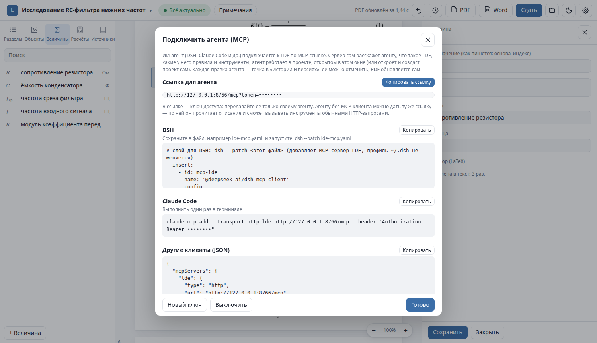

# AI agents (MCP)

LDE is built for an author and an AI agent working on the same report: the agent writes, calculates
and checks; the author reviews in Studio and can undo any of the agent's steps.

The integration is a built-in [Model Context Protocol](https://modelcontextprotocol.io) server.

## Connect

### From Studio

1. Open the project in Studio.
2. Click the project title → **«Подключить агента (MCP)…»** (*Connect an agent*) → **«Включить»** (*Enable*).
3. Copy the snippet for your client.



The link (`http://127.0.0.1:8766/mcp?token=…`) is stable across restarts: the key is stored in
`~/.config/lde/mcp.json` (mode 0600) and the server starts together with Studio while it is enabled.
**«Новый ключ»** (*new key*) revokes all previous links; **«Выключить»** (*disable*) stops the server.

The agent works **in the project open in the window** and follows it when you switch projects or documents.

### From a terminal

```sh
lde mcp [<project>]            # HTTP server on 127.0.0.1, prints the link
lde mcp --stdio [<project>]    # stdio transport, for clients that launch the server themselves
lde mcp --new-key              # rotate the key
```

### Client snippets

**Claude Code** — once, then restart the Claude Code session (MCP servers are loaded at start):

```sh
claude mcp add --transport http lde http://127.0.0.1:8766/mcp --header "Authorization: Bearer <key>"
# add --scope user to make it available in every folder
```

**Any client with a JSON config:**

```json
{
  "mcpServers": {
    "lde": {
      "type": "http",
      "url": "http://127.0.0.1:8766/mcp",
      "headers": { "Authorization": "Bearer <key>" }
    }
  }
}
```

**stdio:**

```json
{ "mcpServers": { "lde": { "command": "/path/to/lde/bin/lde", "args": ["mcp", "--stdio"] } } }
```

**DSH** — save the layer from the dialog to a file and run `dsh --patch lde-mcp.yaml`.

**Agents without an MCP client** can use the same link: `GET` returns a plain-text description of the
environment, and `POST <url>/tools/<tool>` (JSON arguments) calls a tool.

## What the agent gets

On `initialize` the server sends **instructions**: what LDE is, the order of work and the rules.
Reference texts are available as resources `lde://guide/{overview,format,calc,checks,gost}` and through
the `lde_guide` tool.

The 46 tools:

| Group | Tools |
|---|---|
| Environment and projects | `lde_guide`, `project_status`, `project_list`, `project_open`, `project_create` (new or from DOCX), `document_switch` |
| Reading | `outline`, `read`, `element`, `search`, `list`, `info` |
| Editing | `edit_element` (with a base revision — never overwrites the author's newer edit), `insert_element`, `write_file`, `new_quantity`, `new_abbr`, `new_source`, `new_calc`, `calc_set_param` |
| Checks and output | `check`, `fix`, `status`, `update`, `build`, `render_page` (a PDF page as an image, by number or element), `docx`, `submit` |
| Versions | `save`, `undo`, `redo`, `history`, `version_create`, `diff`, `restore`, `merge_status`, `merge_resolve` |
| Review and server | `share_list`, `share_pull`, `share_decide`, `share_reply`, `review`, `sync` |
| Feedback to LDE developers | `feedback_check`, `feedback_new`, `feedback_analyze` |

`insert_element` and `edit_element` immediately return the checker's findings for the changed place,
so the agent fixes typed numbers and symbols right away.

## How agent edits appear

- Each change is a git commit authored by *"Агент <client> (MCP)"* — a separate point in
  **«История и версии»** that can be compared and undone.
- Changes not yet recorded in the history (e.g. made in an editor) are saved as a separate point first.
- Studio re-reads the files, rebuilds the PDF and shows a notification "Агент: …"; the dialog shows
  connected clients and recent calls.
- Generated and service files (`out/`, `.lde/`, `.git/`, `calc/*/out/`) cannot be written, and paths
  outside the project are rejected.

## Rules for agents

The short version (full text: [`docs/agent-rules.md`](../agent-rules.md), Russian):

- quantities as `{R_ц}`, numbers from calculations as `{=calc.key}`, references as `@fig:…`, sources as `[@key]`;
- never type figure/table/equation numbers or computed numbers by hand;
- do not format manually unless the user asks;
- finish with `check` until "Замечаний нет" (no issues) and look at the result with `render_page`.

A skill for agents that read skills from a folder is in [`skill/lde/`](../../skill/lde/)
(`toolchain/install-skill.sh` installs it for DSH).

## Agent feedback

When LDE gets in an agent's way — a bug, a missing tool, routine that should be one command — the agent
files a report with `lde feedback new` (or the `feedback_new` tool). Reports go to `agent-feedback/reports/`
next to LDE (not committed: they may quote project text) and are listed in Studio → project menu →
**«Обращения агентов»**. See [`agent-feedback/README.md`](../../agent-feedback/README.md).

## Security

- The server listens on `127.0.0.1` only and refuses to bind to other addresses.
- Every request needs the key (`Authorization: Bearer …` or `?token=`), compared in constant time.
- `Host` and `Origin` headers are checked, which blocks DNS-rebinding attacks from web pages.
- The key gives full control over your LDE projects — treat the link like a password and give it only
  to your own agent. Rotate it with **«Новый ключ»** if it leaked.
