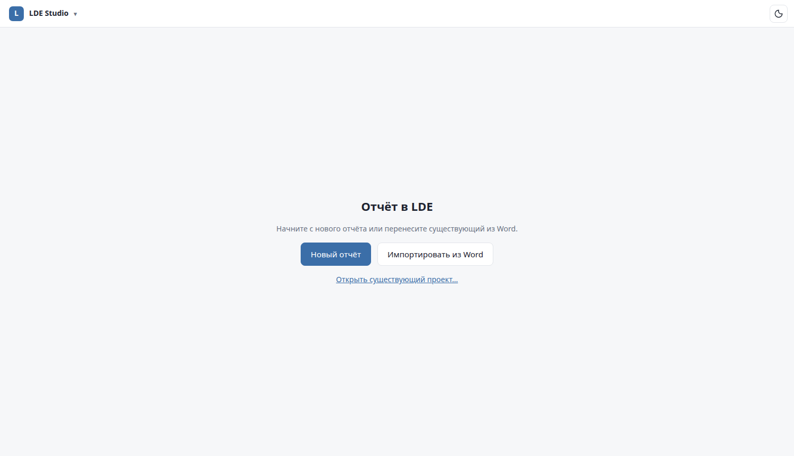

# Getting started

This guide takes you from a fresh clone to a finished PDF and DOCX.

## 1. Install

LDE runs on Linux (x86-64) and installs everything into your home directory — no `sudo`.

You need beforehand:

| Tool | Why | Check |
|---|---|---|
| Python ≥ 3.11 | LDE itself | `python3 --version` |
| git | versions and history | `git --version` |
| Google Chrome or Chromium | the Studio window, UI tests | `google-chrome --version` |
| LibreOffice *(optional)* | self-check of the generated DOCX | `soffice --version` |
| numpy, matplotlib in system `python3` *(optional)* | calculation scripts in the example | `python3 -c "import numpy, matplotlib"` |

Then:

```sh
git clone https://github.com/ia14borzenko/lde.git
cd lde
bin/lde doctor          # what is installed and what is missing
bin/lde doctor --fix    # install the missing parts
```

`doctor --fix` installs, pinned and checksum-verified:

- **TinyTeX** (TeX Live) with the packages LDE needs → `~/.local/share/lde-tools/TinyTeX`;
- **pandoc** → `~/.local/bin/pandoc`;
- a **Python venv** with the packages from `toolchain/requirements.txt` → `toolchain/venv`.

The network is needed only for this step. To put the heavy toolchain elsewhere, create
`toolchain/local.env` with `LDE_TOOLS_DIR=/path/to/lde-tools` (this file is machine-local and ignored by git).

Finally, register LDE as an application:

```sh
bin/lde app install     # `lde` command in ~/.local/bin + "LDE Studio" in the applications menu
```

`lde app status` shows what is installed; `lde app uninstall` removes it.

## 2. Open LDE Studio

Run `lde` in a terminal or start **LDE Studio** from the applications menu (category *Office*).
Studio opens in its own window and the terminal is free again.

- Without a project, Studio shows the start screen: **«Новый отчёт»** (*new report*),
  **«Импортировать из Word»** (*import from Word*), **«Открыть существующий проект…»** (*open*).
- `lde open <folder>` opens a specific project; inside a project folder, plain `lde` opens that project;
  otherwise the last one is reopened.
- There is one Studio per user: launching again opens another window of the same Studio.
  Closing all windows stops it.



## 3. Create a report

From the terminal:

```sh
lde init ~/Documents/LDE/rc-filter
lde open ~/Documents/LDE/rc-filter
```

The example is a short research report about an RC low-pass filter. It shows every kind of element:
sections, a calculation with parameters and a figure, equations with numbers, a table, quantities,
abbreviations and sources. Use it as a template — delete what you do not need.

Or start from an existing Word document:

```sh
lde import-docx report.docx ~/Documents/LDE/my-report
```

The importer converts headings, paragraphs, OMML and MathType equations (with their numbers), figures,
tables, captions, cross-references, citations and the list of sources. What it could not map exactly is
listed in `import/report.md` inside the new project.

## 4. Edit

Click any element of the PDF in Studio to edit it. A few things to know from the start:

- **Do not type numbers, symbols or references by hand.** Use the buttons under the editor:
  **«+ Величина»** (quantity), **«+ Число»** (number from a calculation), **«+ Формула»** (inline equation),
  **«+ Ссылка»** (reference to a figure/table/equation/section), **«+ Цитата»** (citation). `Ctrl+K` opens the picker.
- Press **«Сохранить»** (`Ctrl+S`). The PDF rebuilds in about a second.
- Change calculation parameters on the **«Расчёты»** tab on the left; stale results are shown in the
  status pill at the top and recomputed with **«Обновить»**.

See the [Studio guide](studio.md) for everything else.

## 5. Check and submit

The status pill at the top says **«Всё актуально»** (*all up to date*), **«Устарело: N»** (*N stale*) or
**«Замечаний: N»** (*N issues*). Click it for details and one-click fixes.

When the report is ready, press **«Сдать»** (*submit*) or run:

```sh
lde submit -C ~/Documents/LDE/my-report
```

This recomputes everything stale, runs the checks, builds `out/<name>.pdf` and `out/<name>.docx`,
checks the DOCX against the PDF, and answers whether the report can be submitted.

## Next

- [Source format](source-format.md) — if you prefer editing files in your editor.
- [AI agents](ai-agents.md) — let an agent write and calculate while you review.
- [Review links](review-and-server.md) — send the document to a supervisor.
