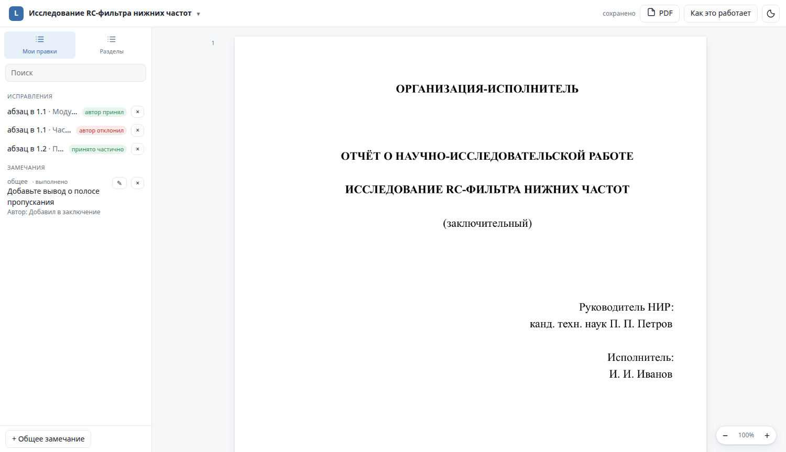
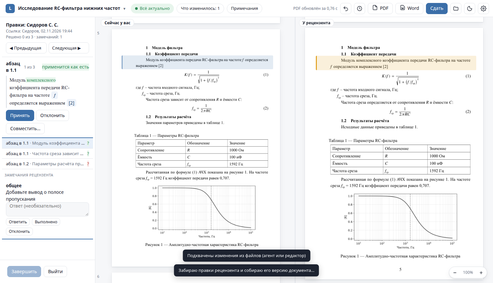

# Review links and the LDE server

LDE works fully offline. A server is needed only to send a document to someone else or to keep a
project in sync between machines and co-authors. You can host it yourself; it **never sees the
contents** — documents, edits, comments, history and even titles are encrypted on the devices.

## Review links

A supervisor or reviewer does not need LDE: they open a link in a browser and get the same Studio in
the reviewer role — the same pages, editing of text and equations, comments.

**Author:**

1. Connect to a server once: `lde server login https://lde.example.org <name>` or Studio → project menu →
   **«Сервер LDE…»**.
2. Studio → project menu → **«Поделиться документом…»** (*share*): who it is for, what they may do
   (edit and comment, or comment only), validity in days, an optional PIN, whether to show the PDF.
3. Send the link. The part after `#` is the decryption key; it never reaches the server.



**Reviewer:** edits paragraphs, equations and captions, leaves comments to places or general ones.
Everything is saved to *their* copy; the author's document does not change.

**Author again:** project menu → **«Ссылки и правки рецензентов»** → **«Разобрать правки»**.
Studio shows both versions side by side and walks through the changes:



- **«Принять»** / **«Отклонить»** / **«Совместить…»** (accept / reject / combine) for each changed block;
- answer comments, mark them done or rejected — the reviewer sees the answers;
- **«Завершить»** records a version "Правки: <reviewer> — учтены".

The same is available from the command line: `lde share new|list|pull|accept|reject|own|reply`.

Comments made in Word can be imported too: `lde review import reviewed.docx`.

## Project sync

`lde publish` uploads the project to the server (as encrypted `git bundle` packs);
`lde sync` pulls and pushes with block-level merge; `lde clone <id> <folder>` gets it on another machine;
`lde remote member …` manages co-authors (owner, editor, reviewer, reader).
In Studio: project menu → **«Синхронизировать с сервером»**.

## Deploying `lde-server`

The server is Python standard library + SQLite, packaged as a Docker container.
Full instructions (Russian): [`lde-server/README.md`](../../lde-server/README.md).

**On a clean machine** (Caddy obtains a TLS certificate):

```sh
cp lde-server/env.example lde-server/.env      # set LDE_DOMAIN and LDE_PUBLIC_URL
docker compose -f lde-server/compose.yaml --env-file lde-server/.env up -d --build
```

No domain? `lde.<your-ip-with-dashes>.sslip.io` resolves to your IP.

**Behind an existing nginx**, one command from your workstation (re-running updates):

```sh
lde-server/deploy/deploy.sh <ssh-host> [lde.<ip>.sslip.io]
```

It copies the server to `/opt/lde-server-src`, builds and starts the container on `127.0.0.1:8790`,
and on the first run creates an nginx site and a Let's Encrypt certificate. Other sites are not touched;
`nginx -t` runs before every reload.

**First administrator:**

```sh
docker compose -f lde-server/compose.behind-proxy.yaml --env-file lde-server/.env \
  exec lde-server lde-server invite --admin
```

Open the printed link, choose a name and a password. Further invitations, links, projects and devices
are managed in the web panel at `/panel/`.

## Security model

- End-to-end encryption: AES-256-GCM, X25519, HKDF, PBKDF2 (`lde/crypto.py` and
  `lde-server/web/static/crypto.js` use the same format).
- The password never leaves the device; the server stores `scrypt` of a derived login key. Private keys
  are stored only encrypted.
- Link tokens are stored hashed; keys travel in the URL fragment. Links expire, can have a PIN and can
  be revoked.
- Container: non-root, read-only root filesystem (except `/data`), all capabilities dropped,
  `no-new-privileges`, memory/CPU/process limits.
- HTTP: `HttpOnly; Secure; SameSite` cookies, CSRF checks, rate limiting, a strict CSP without inline
  scripts or CDNs, `Referrer-Policy: no-referrer`, HSTS; the access log is disabled (paths contain link tokens).
- Limitation of in-browser cryptography: the server delivers the panel's scripts, so a compromised server
  could replace them. LDE itself is the primary trusted client.
