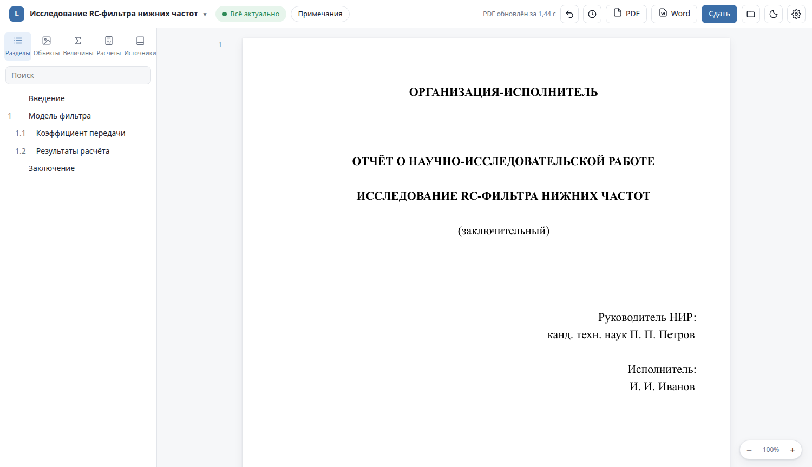
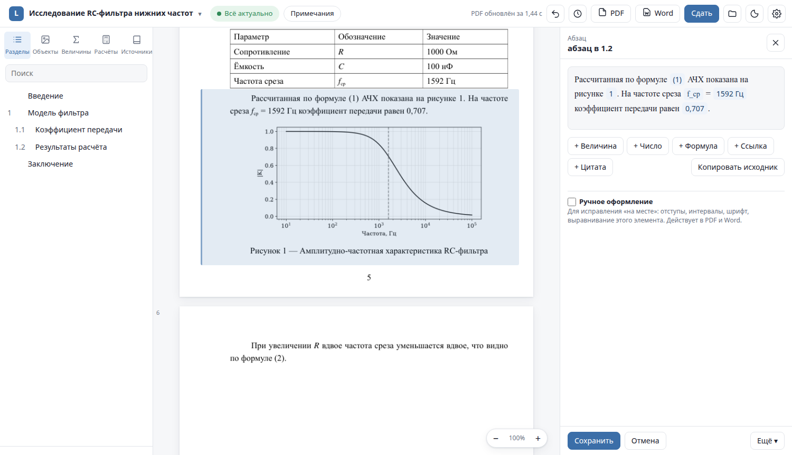
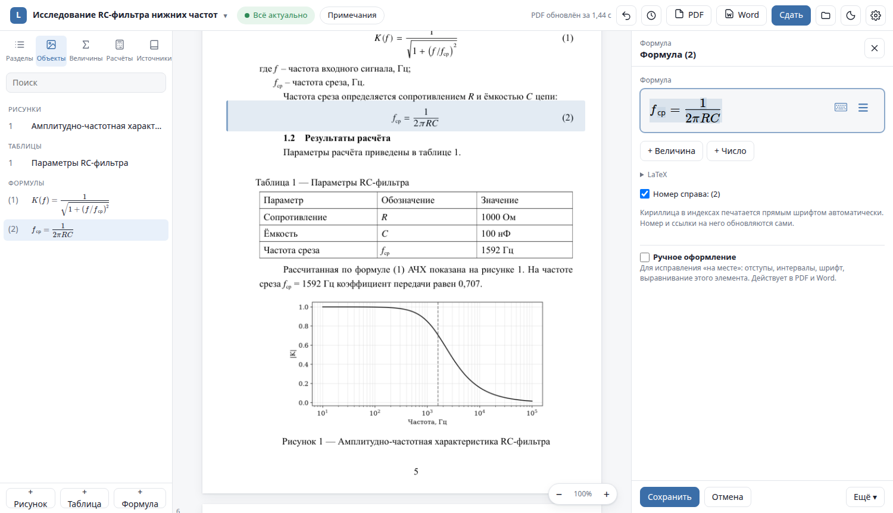
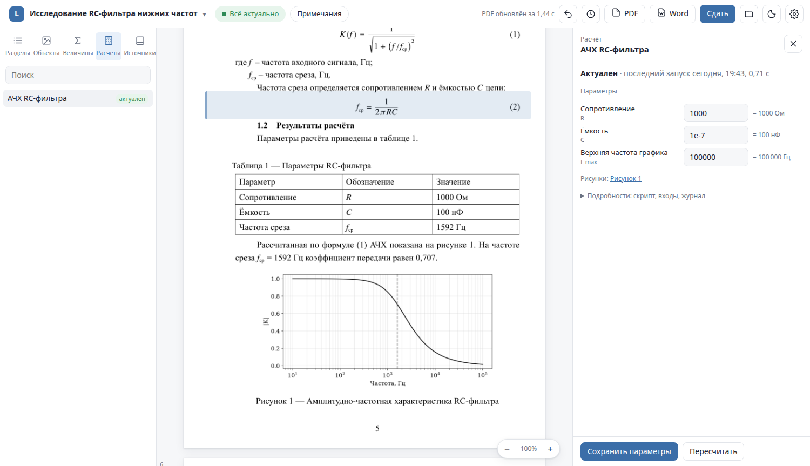
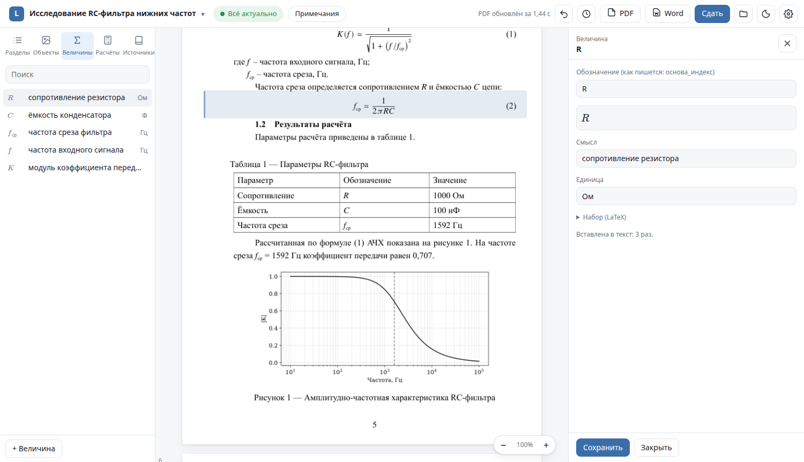
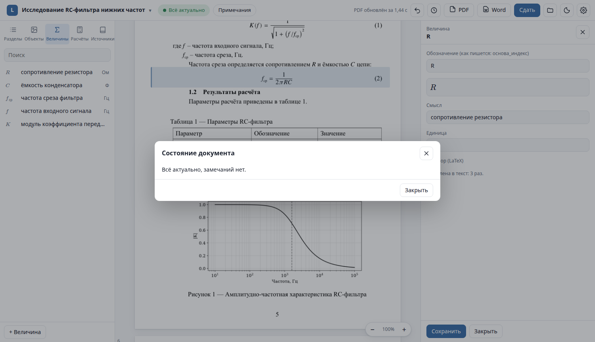
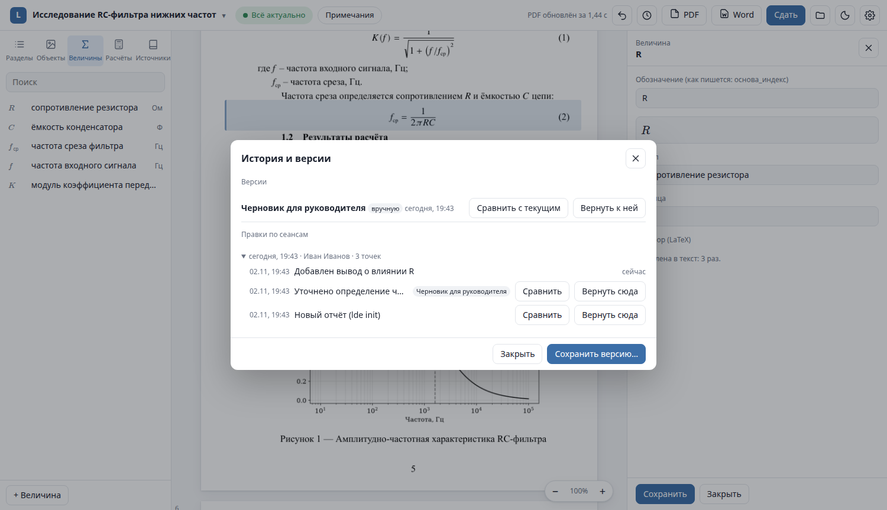
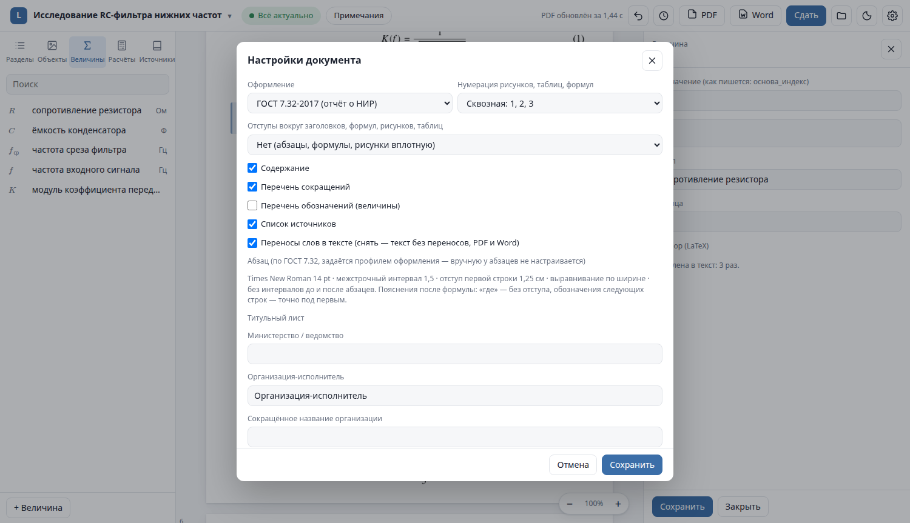
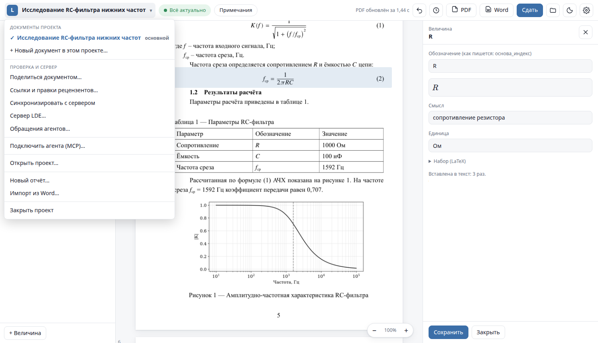
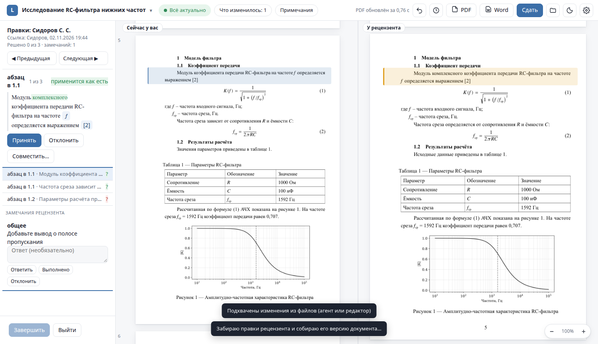

# LDE Studio

Studio is the main way to work with a report. It shows the real PDF and lets you edit any element in
place. Interface labels are in Russian; this guide gives them with a translation.

## Layout

| Area | What is there |
|---|---|
| **Top bar** | project title (click → project menu), status pill, **«Что изменилось»** (changes by an agent or another editor), **«Примечания»** (reviewer comments from Word), undo, history (clock icon), **PDF**, **Word**, **«Сдать»** (submit), project folder, theme, settings ⚙ |
| **Left** | tabs **«Разделы»** (outline), **«Объекты»** (figures, tables, equations), **«Величины»** (quantities), **«Расчёты»** (calculations), **«Источники»** (sources), with search |
| **Middle** | the PDF pages; click an element to edit it; zoom at the bottom right |
| **Right** | the editor of the selected element |

The theme and zoom are remembered; a project reopens on the document and page where you left it.

## Editing a paragraph

Click a paragraph in the PDF. Text is edited as usual; **inserts are chips** — a quantity, a number from a
calculation, a reference, a citation, an inline equation. Click a chip to change it.

- **«+ Величина»** / **«+ Число»** / **«+ Формула»** / **«+ Ссылка»** / **«+ Цитата»** add an insert without
  any syntax; `Ctrl+K` opens the picker.
- `Ctrl+B` / `Ctrl+I` — bold / italic for selected words.
- **«Копировать исходник»** copies the field as LDE source text, inserts included.
- **«Сохранить»** (`Ctrl+S`) saves; the PDF updates in about a second. **«Отмена»** discards.
- **«Ещё ▾»** — edit the raw source of the element, add a paragraph, equation, figure or table after it,
  or delete it.

Every save is a point in the history and can be undone.

## Equations

Equations are edited visually (MathLive). The LaTeX source is available under **«LaTeX»**.
**«+ Величина»** and **«+ Число»** insert a live quantity or calculation result *into* the equation —
it updates when the calculation does. Numbering and references to the equation are automatic;
the checkbox decides whether the equation has a number.

Sizes follow MathType conventions (indices 58 %, second-level indices 42 %, full-size fractions),
so equations look like the ones in Word-made reports.

## Figures and tables

- **Figure:** edit the caption, change the width, replace the file — or, for figures produced by a
  calculation, jump to its parameters.
- **Table:** a grid editor; cells accept the same inserts as paragraphs. A table can also be generated
  from a CSV file of a calculation and then updates with it.

## Calculations

On the **«Расчёты»** tab, open a calculation to see its parameters, outputs and log. Edit a parameter and
save: everything that depends on it — figures, numbers in the text and in equations — is marked stale
(red in the PDF), and the status pill offers **«Обновить»** to recompute exactly what is needed.
See [Calculations](calculations.md).

## Quantities, abbreviations, sources

- **Quantity:** symbol (as written, e.g. `R_ц`), meaning, unit, optional explicit LaTeX. LDE typesets it
  consistently everywhere and can print the list of symbols.
- **Source:** a bibliography entry formatted per GOST 7.0.5; files can be attached.
- **Abbreviation:** goes to the list of abbreviations automatically.

## Status and checks

The status pill shows whether everything is up to date. Click it to see stale calculations and the
issues found by the checker, each with **«Исправить»** (fix) and **«Перейти»** (go to the element),
plus **«Исправить автоматически»** for all fixable issues at once.

## History and versions

The clock icon opens **«История и версии»**:

- **Versions** — named snapshots (for example, "Draft for the supervisor"): compare with the current
  state or return to them.
- **Edits by session** — every save, by you or an agent; compare with any point or return to it.
- Undo (the arrow in the top bar, `Ctrl+Alt+Z`) and redo (`Ctrl+Alt+Shift+Z`) are always available;
  returning to an old state is itself a new point, so nothing is lost.

Comparison shows changes element by element, with word-level highlighting inside paragraphs.

## Document settings

⚙ (or `Ctrl+,`): formatting profile, numbering of figures/tables/equations (continuous or by section),
spacing around blocks, which lists to print (contents, abbreviations, symbols, sources), hyphenation,
and the title page fields.

**Manual formatting** of a single element (in its editor, **«Ручное оформление»**): alignment, indents,
spacing, line height, font size, bold/italic, page break. Use it to fix a single unlucky place; the
element is then no longer auto-formatted until you clear the checkbox. It applies to both PDF and DOCX.

## Project menu

Click the project title: documents of the project (a project can hold several documents sharing
quantities, sources and calculations), sharing and review links, sync with a server, agent inbox,
**«Подключить агента (MCP)…»** (connect an AI agent), open/new/import, close.

## Review mode

When a reviewer has edited a shared copy, open it from **«Ссылки и правки рецензентов»** →
**«Разобрать правки»**. Studio shows your pages and the reviewer's side by side; go through the changes
(`F7`) and **«Принять»** (accept), **«Отклонить»** (reject) or **«Совместить»** (combine) each one, answer
comments, then **«Завершить»** to record a version. See [Review links](review-and-server.md).

## Keyboard

| Key | Action |
|---|---|
| `Ctrl+S`, `Ctrl+Enter` | save the element |
| `Ctrl+K` | insert a quantity / number / reference / citation |
| `Ctrl+B`, `Ctrl+I` | bold, italic |
| `Ctrl+Alt+Z`, `Ctrl+Alt+Shift+Z` | undo, redo the last saved change |
| `Ctrl+E` | export to Word |
| `Ctrl+=`, `Ctrl+-` | zoom |
| `Ctrl+,` | document settings |
| `F7`, `Shift+F7` | next / previous change in review mode |
| `Esc` | close the menu, a dialog or the editor |
